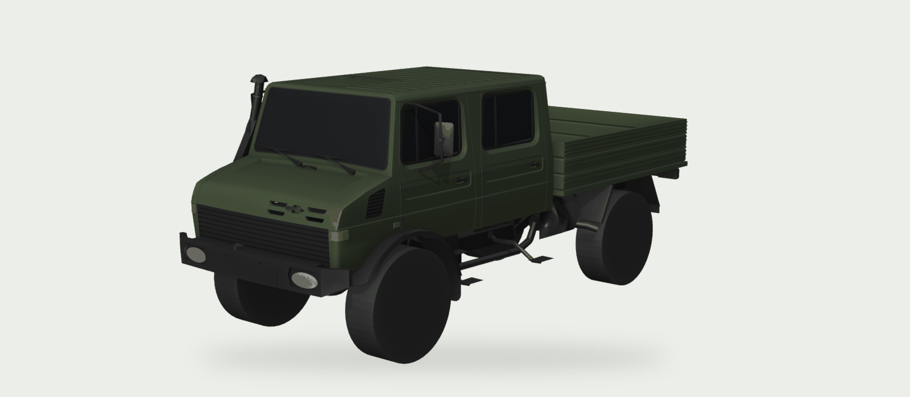
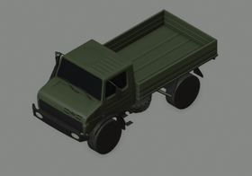
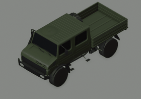
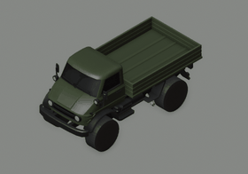
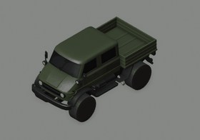
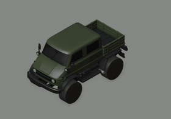
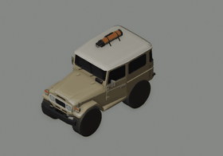

# Die Kollektion Werkstatt

[](vehicles/megaloceros/)

A vehicle mod system for *Over the Hill*: it adds new vehicles to the game's merchant and changes stock ones, built on your own machine from your own copy of the game. **Die Kollektion** is the example set of vehicle packs made with it: four trucks (above, Das Megaloceros), a patch for the stock Mammoth, and a golf bag on The Ding's roof. Clone it, run one command, and it walks you through the rest.

## What you need

- **Over the Hill** on Steam, the native Linux build. Windows support is planned (the cross-platform CLI and plugin build are in the design), not ready yet.
- **A Linux machine** (Arch, Debian/Ubuntu or Fedora; `make start` prints the install command for yours) with:
  - **Python 3.10 or newer**, for the build tools;
  - **rsvg-convert** (`librsvg`) and **potrace**, to draw the vehicle icons;
  - **make**.
- **The download:** the [latest release](https://github.com/aaronsb/die-kollektion/releases/latest) zip, which carries the plugin ready-built, so you need nothing more. Building from source instead (git clone or **Code → Download ZIP**) also needs **the .NET SDK 6 or newer** to compile the plugin; after a game update the release zip compiles it too, so keep the SDK at hand then.
- **Blender 5** is optional: only for contact-sheet renders and editing the cab models.
- **About 1 GB of free disk**: the mod loader (BepInEx) in the game folder, Python packages and build output.

## Get it running

Download `die-kollektion-werkstatt-<version>.zip` from the [latest release](https://github.com/aaronsb/die-kollektion/releases/latest) (the same zip is on [Nexus Mods](https://www.nexusmods.com/overthehill/mods/51)), unzip it, and in that folder run:

```sh
make start
```

Or from source: `git clone https://github.com/aaronsb/die-kollektion && cd die-kollektion && make start`.

`make start` checks everything and prints one next step: install a missing program, `make setup`, `make bepinex` (the mod loader), the Steam launch option (Werkstatt's launch script, which also rebuilds the plugin after a game update), starting the game once, then `make all`, which builds the trucks and installs the mod. Run `make start` again after each step until it says everything is ready. Each step is explained in [Setup in detail](#setup-in-detail).

**Fastest: ask your agent.** Open this folder with an AI coding agent (Claude Code, or any agent that reads [`AGENTS.md`](AGENTS.md)) and say "set me up". It runs `make start` step by step, explains each step, and tells you when you need to click something in Steam.

## The vehicles

Each vehicle is one folder; its page is a contact sheet: renders, a rig view of its colliders and attach points, and the results of the mesh checks.

| | Vehicle | Kind | |
|---|---|---|---|
|  | **Das Glyptodon**: square-cab two-door with a drop-side bed and snorkel | based on the Mammoth (own cab, frame and bed) | [contact sheet](vehicles/glyptodon/) |
|  | **Das Megaloceros**: square-cab crew cab on a long wheelbase, spare in the bed | based on the Mammoth (own cab, frame and bed) | [contact sheet](vehicles/megaloceros/) |
|  | **Das Mastodon**: round-cab two-door, long wheelbase, ribbed steel bed | based on the Mammoth and the mechanic's truck | [contact sheet](vehicles/mastodon/) |
|  | **Das Megatherium**: round-cab crew cab, long wheelbase, side-exit exhaust | based on the Mammoth | [contact sheet](vehicles/megatherium/) |
|  | **Das Mammoth**: the stock truck with portal axles, coil springs, a side-exit exhaust and more steering lock | patch | [contact sheet](vehicles/mammoth/) |
|  | **The Ding**: a starter car with a golf bag strapped to its roof, the canary for patching stock vehicles | patch | [contact sheet](vehicles/dingding/) |

The four trucks run warm halogen headlights, a little dimmer than the stock cars' ([at dusk](docs/images/halogen-headlights.jpg)); a manifest's `headlights` block sets them.

## Made with AI, for people with agents

Everything here (code, models, textures and docs) was authored with AI. That is also how we expect most people to use it: an agent is what lets someone who simply loves a truck get it into the game without first learning decompiling, mesh pipelines and plugin crash rules. Werkstatt is agent-friendly on purpose. Point your agent at [`AGENTS.md`](AGENTS.md); it tells the agent how to help, whether you want it to just make things work or to coach you while you stay in creative control.

## What they're modelled on

In the game every vehicle has a fictional name. Here is the real vehicle behind each one.

<!-- catalogue -->
| In game | Family | Variant | Real vehicle | Series | About the real vehicle | How faithful |
|---|---|---|---|---|---|---|
| [Das Glyptodon](vehicles/glyptodon/) | Glyptodon | two-door | Mercedes-Benz Unimog U 1300 L, two-door cab | 435 | A two-door truck of the 435 series with an angular cab on a 3.25 m wheelbase and a 1.86 m track, on 14.5R20 tyres (1090 mm across). Steel drop-side bed, black plastic fender flares, slatted black grille, black steel bumper carrying the headlamps, and a raised air intake on the right A-pillar. | Modelled from photos and a dimensioned drawing: wheelbase, track, tyre size, bed length and ride height follow them. |
| [Das Megaloceros](vehicles/megaloceros/) | Glyptodon | crew cab | Mercedes-Benz Unimog U 1300 L (styled), crew cab | 435 | No crew-cab U 1300 L was built. The nearest real reference is the U 1550 L/37 crew cab: 3.70 m wheelbase, 5.56 m overall, 1.01 m front overhang, a 2.70 m body starting 70 mm behind the cab, and a 15.8 m turning circle on 12.5R20 tyres. | Fictional: this model never came as a crew cab. The two-door's front and running gear with a crew cab, on the 3.70 m wheelbase of the U 1550 L/37 crew-cab drawing. |
| [Das Mastodon](vehicles/mastodon/) | Mammoth | two-door, long wheelbase | Mercedes-Benz Unimog U 1100 L, two-door cab | 416 | A two-door truck of the 416 series with the rounded cab. | The game's Mammoth on a 2.90 m wheelbase with the mechanic truck's single cab and front, portal axles, coil springs and a ribbed steel bed. |
| [Das Megatherium](vehicles/megatherium/) | Mammoth | crew cab, long wheelbase | Mercedes-Benz Unimog U 1100, crew cab | 416 | A crew-cab truck of the 416 series with the rounded cab. | The game's Mammoth crew cab on a 2.90 m wheelbase with portal axles, coil springs, a side-exit exhaust and a ribbed steel bed. |
| [Mammoth (patch on the stock car)](vehicles/mammoth/) | Mammoth | stock, patched | – | – | – | A patch on the game's stock Mammoth: portal axles, coil springs, side-exit exhaust and more steering lock. |
| [Ding (patch on the stock car)](vehicles/dingding/) | Ding | stock, with a golf bag on the roof | – | – | – | A patch on the game's stock Ding (a starter vehicle): one golf bag strapped to the roof, the canary for modding a stock vehicle. |
<!-- /catalogue -->

## Making your own

Most people will want to tweak a stock car rather than build a new one, so that is the shortest path in Werkstatt: `kollektion new patch <Car>` writes a patch listing every chassis and suspension value, with the car's current numbers in a `stock` block beside them. Change a number, build, install; no Blender. Geometry and upgrade changes add Blender on top of the same patch. The CLI isn't built yet; [`docs/vehicle_factory.md`](docs/vehicle_factory.md) has the design.

## Setup in detail

There are no release builds yet: Werkstatt builds the mod on your machine from this repo, using parts of your own copy of the game, and installs it into the game folder. Every step is a command you paste into a terminal, or a click path in Steam.

1. Install Over the Hill in Steam, start it once, get past the intro, and quit. This creates your save.
2. Install `make` if you don't have it:
   - Arch: `sudo pacman -S make`
   - Debian, Ubuntu: `sudo apt install make`
   - Fedora: `sudo dnf install make`
3. Get Werkstatt. No git needed: on the [repository page](https://github.com/aaronsb/die-kollektion), click **Code → Download ZIP**, unzip it, and open a terminal in the unzipped folder. (With git: `git clone https://github.com/aaronsb/die-kollektion && cd die-kollektion`.) To update later, download the ZIP again.
4. Run:
   ```sh
   make start
   ```
   It checks everything and prints **one** next step, with the exact command to paste or the place to click. Do that step, then run `make start` again. Repeat until it says everything is ready. Along the way it has you:
   - install a few programs with your system's package manager (it prints the command for your system);
   - run `make setup` (Werkstatt's Python packages);
   - run `make bepinex`: it downloads BepInEx, the mod loader (33 MB, from the official build server, after asking you), checks it against the pinned checksum, installs it into the game folder and sets it up;
   - tell Steam to start the game through Werkstatt's launch script, which `make bepinex` has just put in the game folder: Library → right-click Over the Hill → Properties → General → Launch Options, and paste `"./run_werkstatt.sh" %command%`. It starts BepInEx; after a game update it starts the game once without the mod and, when you quit, rebuilds the plugin for the new version. Already set up with `"./run_bepinex.sh" %command%`? Run `make deploy` first (it installs the script), then change the option;
   - start the game once from Steam and quit at the main menu. BepInEx uses this first start (slow, once) to prepare files the Werkstatt plugin is compiled against, which is why the mod can only be built after it;
   - run `make all`: it copies the parts it needs from your game, builds the trucks, checks them and installs the mod (about a minute).
5. Start the game. The trucks are at the merchant. Optional, with the game closed: `make save-add` puts all four in your garage.

**Your save.** Back up `~/My Games/over the hill/Saves/` before you start, and edit a save only with the game closed (and Steam Cloud in mind). `make save-add` writes the save only when a truck is missing, and backs it up first to `~/My Games/over the hill/DieKollektion/backups/` (outside `Saves/`, so Steam Cloud doesn't sync the backups; the last ten are kept). A save that holds one of these trucks still lists it after the mod is removed; how the game treats that is not yet tested.

**Undoing it.** `make undeploy` removes exactly the files `make deploy` installed. To remove BepInEx as well, clear the Steam launch option and delete `BepInEx/`, `dotnet/`, `libdoorstop.so`, `run_bepinex.sh`, `run_werkstatt.sh`, `.doorstop_version` and `changelog.txt` from the game folder.

## Werkstatt commands

`make help` lists them. The ones you'll use:

| Command | What it does |
|---|---|
| `make start` | Checks your setup and prints the one next step. Also the default: plain `make` does the same. |
| `make doctor` | Every check at once, each with what it is and how to get it on your system. |
| `make setup` | Creates `.venv/` and installs the Python packages. |
| `make bepinex` | Installs BepInEx from the pinned build in `tools/bepinex.json` (asks before downloading, checksum-verified; `BEPINEX_ARCHIVE=<zip>` installs a file you downloaded yourself), makes its start script runnable, installs Werkstatt's launch script `run_werkstatt.sh`, and turns its Unity log listener off. |
| `make extract` | Copies the game parts the trucks are built from into `extracted/` (never committed or shared). |
| `make build` | Builds every vehicle in `vehicles/`: meshes, icons. |
| `make check` | Runs every gate: holes and slivers on each built mesh (with any exception a vehicle declares in its manifest's `gates` block), the game-update handling tests, real names outside the catalogue, the catalogue itself. |
| `make deploy` | With the game closed: runs the gates, compiles the plugin and installs it with the vehicles into `BepInEx/plugins/VehicleMods/`, recording every file in `deployed.json`. An older install not made this way is moved aside, next to `plugins/`. `DEPLOY_DIR=<dir>` installs somewhere else to inspect it. |
| `make undeploy` | Removes exactly what `deployed.json` lists (`FORCE=1` if you changed those files since; `make deploy` needs it too then). |
| `make save-add` | With the game closed, puts the four trucks in your save (`PROFILE=<name>` for another profile). |
| `make save-test`, `make save-real` | With the game closed, swaps in a test save where every car owns every part, to preview each one in the garage; `save-real` puts your own save back. |
| `make update` | After a game update, with the game closed: rebuilds the plugin for the new version and installs it again (the launch script does this on its own). When this checkout isn't the one deployed, it deploys it in full, with the gates. |
| `make status` | Compares the repo, the build and the game folder, and says whether the plugin fits the game's version. |
| `make all` | `extract`, `build`, `deploy`, after checking the setup is done. |
| `make contact` | Renders every vehicle's contact sheet (needs Blender). |
| `make pack` | Builds the shareable zip of the Die Kollektion pack into `dist/` (only our own files). |

The game folder is found through Steam's library list; pass `GAME_DIR="/path/to/over the hill"` if yours isn't found. Underneath, the targets run the scripts in `tools/` (`werkstatt.py` for setup, gates and deploy bookkeeping; `export_game_data.sh`; `make_glyptodon.py`, `make_megaloceros.py`, `build_vehicle.py`; `trace_icons.py`, `rasterize_icons.py`; `contact_sheet.py`) and `dotnet build` in `plugins/VehicleMods/`.

Nothing taken from the game is committed here: `make extract` writes it into `extracted/`, and each vehicle's `build/` and `generated/` folders hold what is made from it; all three are gitignored.

Each vehicle is one self-contained folder, `vehicles/<name>/`: its manifest `vehicle.json` (whose `kind` says whether it is novel, based on a shipped vehicle, or a patch to one), its own meshes and Blender masters, its icon, and its contact sheet (`README.md`, written by `tools/contact_sheet.py`).

## How changes are reviewed

Changes to this repository arrive as pull requests on GitHub, where you review them by reading the diff and the before-and-after contact sheets; driving a change first is optional. [CONTRIBUTING.md](CONTRIBUTING.md) covers branches, pull requests and how to drive one; none of it is needed to play or to build your own vehicle.

## Documentation

- [`docs/engine.md`](docs/engine.md): what we know about the game as a modding target, the crash rules the plugin follows, and the mesh pipeline.
- [`docs/vehicle_factory.md`](docs/vehicle_factory.md): the design draft for Werkstatt: packs and manifests, the three kinds of vehicle, lifecycle, textures and liveries, contact sheets and the planned CLI.
- [`AGENTS.md`](AGENTS.md): how an agent should help you, plus commands, gates and working rules.

## Licence

Code is GPL-3.0-or-later; art (models, meshes, icons, vehicle definitions) is CC BY-SA 4.0. Packs are data, not derivative works of the plugin. See [`COPYING.md`](COPYING.md). Not affiliated with Funselektor or with any vehicle manufacturer.
