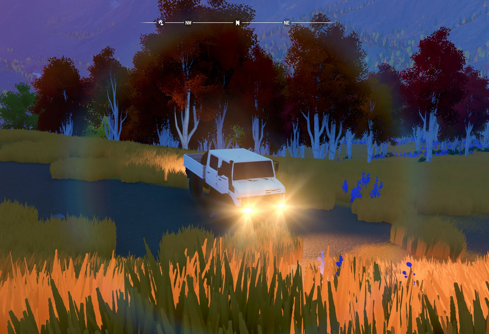

# Engine, loader and mesh facts

What we know about *Over the Hill* (Funselektor) as a modding target, and what the plugin and tools rely on. Learned on the native Linux build; Windows is untested.

## Engine

- Unity 6000.0.75f1, IL2CPP (metadata v31), URP. FMOD Studio is the audio middleware only (`StreamingAssets/*.bank`).
- Content ships as Addressables bundles in `over the hill_Data/StreamingAssets/aa/StandaloneLinux64/`. Type trees are present, so UnityPy reads MonoBehaviour fields by name.
  - `cars_assets_all_*.bundle`: vehicle prefabs (`Car_<Codename>`), meshes, textures.
  - `scriptableobjects_assets_all_*.bundle`: car definitions, liveries, upgrade lists, engine tiers, tyre configs, icons.
  - `localization-string-tables-english(en)_*.bundle`: display names and descriptions.
- Official mod support is liveries only (mod.io and `~/My Games/over the hill/LocalLiveries/`). A new vehicle needs a code mod.

## Stock roster (the cars the catalogue has)

| Codename | Display | Bed | Collider length (m) | Wheel radius (m) | Travel (m) |
|---|---|---|---|---|---|
| Mammoth | Das Mammoth | yes | 4.24 | 0.52 | 0.70 |
| RustOx | Das Rust Ox | no | 4.87 | 0.36 | 0.60 |
| Lynx | Das Lynx | no | 3.68 | 0.40 | 0.35 |
| Wombat | Das Wombat | no | 3.88 | 0.43 | 0.55 |
| Marshal | The Marshal | no | 4.38 | 0.52 | 0.70 |
| Baguette | Rancho, catalog-excluded | no | 4.38 | 0.30 | 0.25 |
| Grizzly | Grizzly, catalog-excluded | no | 3.10 | 0.30 | 0.25 |

Hidden car ItemIds: Baguette `2077913603`, Grizzly `2940455280`. The plugin un-hides both (`HiddenCars.cs`).

## The donor: Mammoth

From `Car_Mammoth` local positions:
- Wheel colliders: front z +1.10, rear z −1.43 (wheelbase 2.53 m); x ±0.90 (track 1.80 m).
- `Axles/SuspensionRigidFront` z +1.11, `SuspensionRigidRear` z −1.43: skinned solid-axle meshes.
- Body: `Parts/Mammoth/Mammoth_body_LOD0..3` under one LODGroup. Collision: `Collider/Top`, `Collider/Base` (MeshColliders).
- Centre of mass (0, 0.65, −0.05). Winch points front z 2.12, rear z −2.24.
- Rear lamps: the body has two sets. The upper blocks (y 0.97-1.11) carry the brake/position emitters (`Lights/*PositionBrakelight`, `*BrakingBrakelight`, root y 1.04); the lower round lamps (y 0.69-0.85) are red plus the reverse light (root y 0.80).

Atlas (material `Mammoth`): `Mammoth_masks` is blue where the livery paints and green for glass (red+green is a lamp lens, which the shader keeps lit and snow-free); `Mammoth_skin00` is the default livery; `Mammoth_AO` carries baked shading. UV (0.635, 0.59) is clean painted cab roof, used for repainted parts. Our hand-made parts are flat-coloured from atlas points, so they need no UVs.

The mechanic's truck (`r1_canada` scene bundle, scale 100, offset (0, −0.071, 0.086) onto the Mammoth) shares the Mammoth's UV layout, and its LOD0 matches the Mammoth's LOD0 face for face ahead of the cab.

## Suspension (VPP)

- Each corner is an independent `VPFunselektor3DRaycastWheelCollider` (`Axles/WheelColliders/Wheel{FL,FR,RL,RR}`, hub at root y 0.45). `VPVehicleController.axles` only pairs wheels for steering, brakes and drive. There is no anti-roll bar on the Mammoth. The solid axle is visual only: a skinned mesh following the hub bones.
- The per-car values live in `CarInfo.suspensionSetup`; the Mammoth's match its prefab: radius 0.52, travel 0.70, anchor 0.40, spring 40000, damper 7000, preload 0, unsprung mass 55, bump-stop rate 400000, bump travel offset 0.16. Rigidbody mass 3200 kg.
- VPP reads the prefab's wheel-collider fields at `VehicleBase.Spawned`; nothing visible applies `CarInfo.suspensionSetup` to the wheels (the suspension-lift upgrade reads its base travel from it). A definition's `suspension` block therefore sets the wheels in the Spawned prefix and, for a derived car, writes a copy into its CarInfo.
- `suspensionAnchor` is read as a fraction measured up from full extension (Unity's convention); driving bears this out.
- Toggling `VPVehicleController` off and on breaks the vehicle.

## Saves and part ownership

- The save (`~/My Games/over the hill/Saves/<profile>.json`, one compact JSON line, `Header.Version` 11) keeps no "unlocked" flag for parts. The garage offers what the save says a car owns (`InventoryUtility.IsOwned(item, vehicleItemId)`; `IsAvailableToBuy` and the merchant's `lockSprite` cover the rest):
  - a cosmetic or performance upgrade is a `VehicleSpecificItem` with one `VehicleStates` entry `{"VehicleItemId", "Count"}` per car that owns it (the save shows no other key on states; the interop's `VehicleState` also declares `InUse`);
  - a livery is an `InventoryItem` with a `Count` (an entry without one, Count 0, isn't owned).
- Cosmetics cost nothing (`Price` 0 on all 197); rewards unlock them, and an unlock writes a state for every car in the catalogue at that moment. The 16 performance upgrades cost money and are bought per car.
- A derived vehicle offers its donor's parts: the plugin clones the donor's `CarInfo`, and the clone keeps its `UpgradesLists` reference (Mammoth: 183 cosmetics, 16 upgrades, 10 liveries).
- So a truck registered after some cosmetics were unlocked doesn't own those: in the user's save (2026-10-19) 44 cosmetics carry states for the 21 stock catalogue cars only, while the Kayak, unlocked after our trucks existed, carries all four of theirs. `make save-test` gives every car every part for testing; it swaps the whole `Saves/` folder, since `FogOfWar/` and `Animals/` hold progress too.
- Each car's parts list is `CarInfo.UpgradesLists.Parts`; `tools/export_parts.py` writes them all to `extracted/parts.json` (23 cars, 459 parts in the 2026-10-19 build; 34 cosmetics need a DLC, and the game's entitlement check drops those on load when the DLC isn't owned).

## Lights

- Each car prefab has a `LightsController` on `Lights` with five light groups (`LightsController.TurnableLights`: a `Config`, its `Lights` and lens flares). All 23 car prefabs point each group at the same shared `CarLightConfig` asset in the cars bundle (read with UnityPy, 2026-10-19 build):

  | Group | Config | Colour | Intensity | Range |
  |---|---|---|---|---|
  | `headlights` | `HeadLightConfig` | (0.996, 0.833, 0.659), about 4200 K | 9 | 120 |
  | `fakeBounceLights` | `FakeBounceLightConfig` | (0.961, 0.878, 0.831), about 5300 K | 0.4 | 50 |
  | `rearlights` | `BrakeLightPositioningConfig` | (0.706, 0, 0.090) | 2 | 10 |
  | `brakingRearlights` | `BrakeLightBrakingConfig` | (0.706, 0, 0.090) | 15 | 12 |
  | `reverselights` | `ReverseLightConfig` | (1, 0.945, 0.820) | 15 | 12 |

- The prefab `Light` components of every group except the bounce light hold intensity 0 and range 0 (the bounce light: 0.3 and 30), and none uses colour temperature (`m_UseColorTemperature` off on all 204). The game sets them from the config at run time: `TurnOnLights` runs a DOTween whose setter closure (`__c__DisplayClass51_0`, captured fields `turnableLights` and `__4__this`, setter `_TurnOnLights_b__0(float t)`) drives the group's lights, and `CarLightConfig` carries `SwitchDuration` and `AnimationEase` for it. The decomp is interop stubs without method bodies, so which fields each call copies (colour once at setup, or again at each switch-on) isn't visible; a change has to hold either way.
- The lamp lens glow is a shader scalar on the car's `MaterialPropertyBlock` (`TurnableLights.ShaderParameterID`, `UpdateShaderProperty(int, float)`), not a colour.
- Changing a shared config changes every car. A per-vehicle change goes on that vehicle's own copy of the config, assigned to its spawned instance's group (a definition's `headlights` block).

  

  Das Megaloceros with its `headlights` block (3200 K, ×0.8 intensity), 2026-10-19.

## Upgrade nodes

- Every upgrade the garage fits is a node under the car's `Parts/*_CosmeticParts` node (not always the car's own name: `DingDing_SUV_CosmeticParts`, `TrailRat_CosmeticParts`), in `Visual/<slot group>/` (Front, Front_Bumper, Roof, Roof_Bar, Bed, Fender, Side, Side_Step, Antenna, Rear, Rear_Bumper) or `Performance/` (Winch, Snorkel, Rollcage). A node carrying a `VehicleUpgradeObject` is an option: its `vehiclePartReference` names the part (`VehicleCosmetic` with a `CosmeticType`, or `VehicleUpgrade`), and the game shows the option by activating that node, inactive in the prefab. `Performance/Winch/Winch_01` (the bumper winch) and `Rollcage/rollcage` have no part reference, and the game never shows them. The meshes are shared between cars and stored in centimetres; each car fits them with its own transforms, often non-uniformly scaled. Mammoth: 196 options, 2,431 nodes under the cosmetic root; The Ding: 196 and 2,289 (`make extract` writes them to `extracted/<donor>/upgrades.json` with each option's LOD0 meshes, `tools/export_upgrades.py`; a car without the node gets a file with no nodes).
- A definition's `toolNodes` (node path -> toolset ItemId, `ToolNodes.cs`) shows such a node while the vehicle's loadout carries that tool and hides it otherwise; our four trucks show `Winch_01` while they carry the portable winch (2317836723). That tool is a ground anchor for the built-in winch (`Winch`, which works without it); the node follows the loadout, not the charges left (`CarInventory.AvailableItems`, one used per anchor placed). The loadout is the save's `VehicleItem.ToolsetIDs`: the car's networked `CarInventory.EquippedItems` is filled from it at spawn, and the mechanic's Tools screen edits it in place without touching the spawned car. The mechanic's Close always respawns the car (also when nothing changed), so the spawned car follows the loadout from its spawn alone (`VehicleCustomizationController.Spawned`); display dummies follow it on every `RefreshMountedUpgrades` and after each change in the Tools screen (`StateMerchantMenu.RefreshToolsPanels`, only while the dummy shows the vehicle the screen edits). A dummy refreshed for another car (the stock donor shares our trucks' dummy prefab) first hides the previous truck's tool nodes. A node shown on a dummy takes the layer of the dummy's fitted options, which the game moves to a layer of their own. The loadout comes from the exact VehicleItem where there is one: the one the Tools screen edits, else the current vehicle, else the inventory's item with that ItemId. A patch ignores `toolNodes` (it is the stock car). A malformed block costs only that vehicle its tool nodes, with a `Tools:` log line; each spawn logs where every tool node stands, and each change on a dummy logs one line. A remote player's truck isn't recognised as ours, so it shows no winch; a lobby dummy of another player's truck shows our own loadout for that truck. `make check` runs the reader and the decision over cases and every manifest's block (`tools/toolnodes-check`).
- A derived vehicle runs on its donor's prefab, so its options sit at the donor's transforms. The reshape moves them only with the wheelbase sweep (nodes behind the body cut move back with the rear), so on a vehicle with its own body the items float or sink. Both the spawned car and the garage's display dummy are reshaped (`VehicleBase.Spawned`, `LocalVehicleCustomizationController.RefreshMountedUpgrades`), so whatever the reshape does to a node shows in the mechanic's preview too.
- A vehicle's `placements.json` (beside its `vehicle.json`, deployed beside its meshes) moves, turns and scales nodes after the reshape, parents first, and adds copies of an option or of a piece inside one (`PlacementPlan.cs`, `Placements.cs`). Entries are deltas: offset in metres and rotation in Euler degrees (Unity order z, x, y) in car-root axes as turned and scaled by the node's placed ancestors, about the node's pivot, and a factor on its local scale, so along the node's own axes (the add-on refuses a non-uniform scale on a node the prefab turns, which it can't show yet); an entry on a slot group moves every item in it. A copy whose path lies inside its source (`…/Camper/Camper~2`) becomes the source's child, any other copy its sibling (`…/Party_Bed/AccessoryBeerBarrel~2`, a piece inside the same option); every `VehicleUpgradeObject` in a copy is removed, so the game shows a copy exactly when it shows the item, and options nested in a copy stay hidden. Copies are cloned from the untouched sources before any entry applies, and wake only once placed. A copy of a node whose subtree carries a `Rigidbody` or a `Joint` (the swinging and dangling items) is refused; an entry on such a node is skipped while the node is active, since its joints were set up where it was, and applied while it is inactive (an option not fitted yet), so the joints set up at the new pose when it shows. The Blender add-on (`docs/blender_addon.md`) writes the file; `make check` runs the plugin's reader over `tests/placements/` against the add-on's model (`blender/addons/werkstatt_addon/model.py`). A malformed file costs only that vehicle its placements, with a `Placements:` log line; each applied entry logs one too. `make deploy` removes a deployed `placements.json` whose source was deleted (as it does every file its last deploy recorded); a plain `dotnet build` deploy only copies, so it never removes one.

## BepInEx

- BepInEx 6.0.0-be.789 IL2CPP linux-x64, extracted into the game folder. Steam launch options: `"./run_bepinex.sh" %command%` (`"./run_werkstatt.sh" %command%`, Werkstatt's script from earlier versions, starts it with the same arguments).
- **After a game update** a plugin compiled against the old interop hangs the game at start: BepInEx's log stops at `Chainloader initialized` (Steam build 26047935, 2026-10-19; rebuilding against the regenerated interop fixed it). BepInEx regenerates the interop in its preloader (`Il2CppInteropManager.Initialize`, which writes `interop/assembly-hash.txt`) before the chainloader exists, and the chainloader runs every plugin's `Load` synchronously on Unity's main thread, inside its detour of `il2cpp_runtime_invoke` at the first `Internal_ActiveSceneChanged` (be.789 source, `IL2CPPChainloader.cs`). That is after the window and the Vulkan device exist and about 1 s before the one `InitializeOrResetSwapChain` (Player.log order). So Die Kollektion's loader, the only DLL in `BepInEx/plugins/` and built against BepInEx's own assemblies only, always sees the current interop hash. When it matches the one `deployed.json` records it starts the real plugin from `BepInEx/VehicleMods/` the way the chainloader would (`Assembly.LoadFrom`, `GetType("VehicleMods.Plugin", true)`, `Activator.CreateInstance`, `Load`; BepInEx's resolver finds the interop). When it differs it installs a fitting DLL first, while the main thread waits: the release's prebuilt plugin when it was built for this interop, else a `dotnet build` of the Werkstatt folder recorded at deploy, only while its plugin sources still hash to the deployed ones (`pluginSources`: every `.cs` and `.csproj` in the project plus any `Directory.Build.props`, `Directory.Build.targets` and `global.json` from the project up to the Werkstatt root, in ordinal path order; `werkstatt.py` hashes the same at deploy; the container has no git). The build writes to `BepInEx/VehicleMods.build` (`-o`), so the checkout's own `bin/` is left alone; the loader removes that folder once the install is done or has failed. One deadline (5 minutes) covers the build and the end of its output; past it the build's process tree is killed and the plugin can't start, and a grandchild left holding the output pipes is waited for 5 s at most. The new DLL is copied in under a temporary name, fsynced and renamed over the old; `deployed.json` gets the new interop hash and `afterUpdate`, written the same way, so a power loss leaves the old record or the new one, never an empty one (which would read as nothing deployed). A zenity progress window shows meanwhile, for at least 1.5 s so a fast rebuild draws it (notify-send without zenity); a build took 1.75 s cold in a rehearsal. The loader logs to BepInEx's log and `BepInEx/werkstatt-launch.log`; the main-menu line says `rebuilt for build N` in that session.
- Before deciding anything the loader takes `BepInEx/werkstatt.lock`, the lock `make deploy` holds (Python's `fcntl.flock`; .NET's `FileShare.None` is a `flock` on Unix), waiting 10 s at most, so it never reads a half-written deploy. Then it looks for a `VehicleMods.dll` anywhere under `BepInEx/plugins/` (an install from before the loader, or a branch that still deploys there). BepInEx loads such a copy by itself whatever the loader decides, so the loader doesn't start its own and tells the player to delete the file it names, saying the mod may still load from it; with our trucks in a save the game closes, as for any can't-start. `Plugin.Load` returns on a second call, but with the stray check first that guard almost never runs, and whether it would stop a copy BepInEx loads from another path (only if both resolve to one assembly) is untested.
- **Can't start.** A held lock, a stray copy under `plugins/`, nothing deployed, a missing or empty `BepInEx/interop/assembly-hash.txt` (the loader can't tell which game the plugin must fit, so it doesn't rebuild), no fitting DLL, a failed or timed-out build, and an exception loading or starting the plugin all end in one path. When any save in `Saves/*.json` (every profile; `MY_GAMES` moves the folder) holds our trucks' ItemIds the game would hang loading it (`KeyNotFoundException` on 3000000004, seen 2026-10-19); a save that can't be read counts as holding them. Then a zenity error (shown for a minute at most) names the fix (`make update`), and the loader closes BepInEx's log files and calls libc's `_exit(0)` before any save is read: no managed shutdown or destructors while Unity's threads run. Otherwise the game runs stock with a notification.
- Steam starts the game through its Linux runtime (`SteamLinuxRuntime_soldier`, pressure-vessel), so the loader runs inside the container, where `dotnet`, `systemd-run` and `git` aren't on PATH. The host's SDK is at `/run/host/usr/share/dotnet/dotnet`; alone it fails (`libcrypto.so.3`, then `libbrotlienc`), and with `LD_LIBRARY_PATH=/run/host/usr/lib` it builds, since pressure-vessel already runs the host's glibc. The loader detects the runtime (`/run/pressure-vessel` and `/run/host/usr`) and builds that way, with `-m:1 -nodeReuse:false -p:UseSharedCompilation=false` so nothing outlives the build; the DLL is byte-identical to a host build. Child processes get the game's environment minus `LD_PRELOAD`, Steam's `LD_LIBRARY_PATH` and BepInEx's .NET variables. zenity and notify-send exist inside the container, with the session bus and display.
- Known limits: files added by hand to `BepInEx/VehicleMods/` before a deploy are listed in its `deployed.json` as deployed, so `make undeploy` removes them. A release folder without the .NET SDK can't rebuild after an update until a release built for the new game version is downloaded. The window shows in front of the game's window only because that window isn't fullscreen yet at `Load`; that, and Steam's view of the game during the wait, are untested until a real update.
- `UnityLogListening = false` in `BepInEx/config/BepInEx.cfg` is required (see below).

## What crashes this game

- **Class injection.** Il2CppInterop warns `Class::Init signatures have been exhausted, using a substitute!`, and anything that injects a type then segfaults right after `SettingsManager.ParseLaunchOptions`: BepInEx's Unity log listener, `AddComponent<T>()` of a plugin MonoBehaviour, managed delegates handed to the game.
- **Patching in `Load`.** Crashes the render thread during swap-chain setup.
- **Patching from a background thread while the main thread is busy** (a scene change, or `MainThreadScheduler.Update`, which runs every frame).
- **Managed work during swap-chain setup.** Log polling started in `Load` crashed the main thread during `InitializeOrResetSwapChain` in about 4 of 11 launches. The plugin's thread now sleeps 2 s, then polls with one open stream and a reused buffer, and `Load` touches no IL2CPP type.
- **Dobby's near pages inside coreclr's reservation.** See below.

What works: a background thread waits for `[AddressablesPreLoader] Addressables finished loading` in Player.log, patches only `GameStateManager.Transition`, and that hook's first call (main thread, before the main menu) applies the remaining patches and registers the cars. An exception escaping a plugin thread aborts the game, so plugin threads catch everything.

## Hook pages (`DobbyNearPages.cs`)

BepInEx hooks IL2CPP methods with libdobby, which writes `jmp [rip+disp32]` at the hooked function and keeps the 8-byte target slot (and the relocated prologue) in "near" pages within 2 GB (1 GB for code). It maps those pages MAP_FIXED into no-access memory found in /proc/self/maps, which near GameAssembly is coreclr's ~2 GB executable reservation. Once coreclr commits that range for JIT and loader-heap code, the slots hold instruction bytes and the next call through any hook faults (seen as a crash on entering the mechanic).

`DobbyNearPages` works in two steps. At plugin Load (native calls only, no IL2CPP types) it reserves a 4 MB block, PROT_NONE until used, where `NearBlockPlanner` finds room within 1 GB of GameAssembly's code: the top of the largest unmapped gap (claimed with MAP_FIXED_NOREPLACE, so it can never replace a live mapping), else the top of coreclr's executable reservation (the highest no-access run of at least 32 MB in the reservation that starts at `System.Private.CoreLib.dll`, with at most 1 MB of other mappings above it, ending 64 KB below that run's 64 KB-aligned top; coreclr hands the reservation out strictly upward, so its top is committed last). The reservation's top is claimed with MAP_FIXED, replacing coreclr's no-access memory in place. If the claim at Load fails, it is tried again before the hooks. Before the plugin's own hooks (on the entry thread, after the Addressables line or a 60 s timeout) it re-validates the block (still anonymous no-access memory, or it chooses again) and commits its first four pages: one read-write page for jump slots, two read-execute pages for relocated prologues, and one page for the slots moved off Dobby's pages, made read-only once they are written. It then marks Dobby's existing near pages full, hands Dobby the new ones, and moves the live hooks' slots onto the fourth page. If nothing qualifies it installs no hooks at all, so the game runs without the mod instead of crashing.

Dobby's old pages also hold slots no live jump uses: BepInEx hooks `il2cpp_runtime_invoke` to start the chainloader and removes that hook once the chainloader is up, leaving its slot and relocated prologue behind. Those stay where they are. The log's count of slots with "no live jump" also includes any left unmoved because they were damaged or out of reach.

Reading `BepInEx/LogOutput.log` (these messages start `Dobby pages`, apart from the final `No hooks installed` line):
- `reserved at Load: Gap …` or `ReservationTop …`, with the address range and why it was chosen; `using 0x…-0x… of the … block`; one `retiring near page 0x… (slots|code, …)` per Dobby page; `new hooks use 0x… (slots) and 0x… (code), N MB from GameAssembly's code`; one `moved the slot of the hook at <module>+0x…` per live hook, then `moved N live hook slot(s) to 0x…; M slot(s) on Dobby's old pages have no live jump (hooks already undone)`; after the hooks, `0x… holds N bytes of slots` / `of code`. This is a healthy launch.
- `nothing to reserve at Load`, `reserving at Load … failed` or `the block reserved at Load (0x…) was changed since; choosing again`: the Load claim didn't hold and the planner chose again before the hooks. Harmless if a `using` line follows.
- `hook at <module>+0x… has a damaged slot`: a slot was already overwritten before the move; that hook will fault when called. Capture the maps (below).
- `No hooks installed: Die Kollektion is inactive this session`: the game runs stock. The line before it says why: `no safe place for the hooks' jump slots …` (the planner found nothing in reach; the maps are in `BepInEx/dobby-maps.txt`), `GameAssembly.so not in /proc/self/maps` or `Dobby has no page list` (BepInEx or libdobby changed), or `Dobby pages failed: <exception>` (a fault in the page code itself).
- **No safe block goes through the loader's can't-start policy** (issue #34). Seen on a start where BepInEx regenerated the interop in-process (Cpp2IL and the interop generator, about 10 s, with `assembly-hash.txt` missing; the same happens on the first start after every game update): no 16 KB gap within 1 GB of GameAssembly's code and no 32 MB no-access tail in coreclr's reservation, at Load and before the hooks; the next start found its usual 753 MB tail. Each `nothing to reserve` line saves `/proc/self/maps` to `BepInEx/dobby-maps.txt`. The loader hands the plugin its policy as an AppDomain delegate (`DieKollektion.PluginCantStart`), so the plugin needs no reference to it. A layout with no placement at Load almost always has none before the hooks, and Load is the last point before the game reads a save (Player.log selects the save path after `Addressables finished loading`), so with our trucks in any save the loader's dialog says the memory layout after an update left no safe place and that starting again usually fixes it, and the game closes there, as for any can't-start. Only the planner's "no placement" counts (`NearBlockPlanner.Reservation.NoPlace`); a claim that merely failed (mmap refused, the maps unreadable) is tried again before the hooks. Without trucks the plugin goes on and tries again before the hooks. When that later attempt fails, or the entry hook throws, the game is past Load and may be reading or writing its save, so it never quits there: the saves are read once, and with trucks (or an unreadable save) the dialog says to quit from the main menu without loading the save; without, a notification says the mod is off this session. The loader's delegate also refuses to quit unless called at Load.

Why near memory can't be avoided: BepInEx be.789 offers `DetourProviderType = Dobby | Funchook` in `BepInEx.cfg`, but the Linux build ships no funchook library, and funchook needs near pages too. libdobby exports `dobby_disable_near_branch_trampoline`, which makes the patch at the hooked function a 14-byte absolute jump with no slot; but five of the first seven hooked prologues (2026-10-19 build) hold a RIP-relative `cmpb $0, disp32(%rip)` within their first 14 bytes (the eighth hook, `StateMainMenu.Update` for the main-menu status line, is unchecked), and Dobby's relocated copy of that instruction needs disp32 reach to GameAssembly's data, so the relocated code still has to sit within 2 GB.

2026-10-19, after a game update (Steam build 26047935): no unmapped gap existed within 2 GB of GameAssembly's code, and the old rule (a no-access run of at least 128 MB ending exactly at the reservation's boundary) failed because three 12 KB mappings sat between coreclr's 744 MB tail and the GPU's `renderD128` mapping. The hooks' slots stayed on Dobby's page at coreclr's committed frontier (0x7FE893D78000), which coreclr overwrote with loader-heap data within seconds; the hook on GameAssembly+0x4DAEF40 then jumped to 0x7FE893D5AA22, a non-executable page (SIGSEGV, SEGV_ACCERR) during the logo. `make check` runs `tools/near-plan` over captured layouts in `tests/maps/` (that one, the layout before the update, and two synthetic controls); add a layout there whenever a launch logs a placement problem (`cat /proc/<pid>/maps`, or from a core: `coredumpctl debug <pid>` with `info proc mappings`, permissions from the core's program headers).

## Crash forensics

Player.log ends with `Received signal SIGSEGV` but no native stack. Use the core dump: `coredumpctl list`, then gdb on the core; find `__restore_rt` on the main thread's stack (Unity's alternate signal stack), read the ucontext RIP at uc+40+16*8, and map it to a module and offset (`tools/resolve_crash.py`). A RIP of garbage after a `call` into a GameAssembly function that starts `ff 25` means a damaged hook slot.

## Mesh pipeline

1. `tools/export_car_mesh.py <cars bundle> Car_<Donor> extracted/<donor> <node paths...>` extracts donor meshes (MeshFilter, MeshCollider or SkinnedMeshRenderer) to OBJ in car-root metres, x negated (right-handed, opens in Blender). Skinned meshes add `bw` lines (bone indices and weights) and `bp` lines (bind poses). `tools/export_named_mesh.py` exports Mesh assets by name; `tools/export_images.py` exports textures and icons. All of these read the player's own install; `tools/export_game_data.sh` runs them into `extracted/`, which is never committed.
2. `tools/build_vehicle.py vehicles/<name>/vehicle.json` stretches each mesh behind the body cut unless `"stretch": false`, then runs its `ops` (`tools/meshlib.py`): `portalAxle`, `coilSprings`, `relocatePiece`, `removeRegion`, `insertPart`, `removePieces`, `stretchPieces`, `movePieces`, `widenPieces`, `paint` and `addBoxes`. Part files in the definition are relative to the vehicle's folder, except game parts under `extracted/`. Output goes to the vehicle's `build/` folder.
3. `tools/preview_vehicle.sh vehicles/<name>/vehicle.json` builds and renders side, top, rear and three-quarter views in headless Blender into `renders/<codename>.png`.
4. `make deploy` takes the release's prebuilt plugin and loader when they fit, else compiles them (the plugin with `dotnet build -c Release -p:Deploy=false`), then copies the DLL and, from each vehicle folder, its definition (as `vehicles/<name>.json`), built meshes (`vehicles/<name>/`) and icon (`icons/<Codename>.png`) to `BepInEx/VehicleMods/`, outside `plugins/`, and the loader to `BepInEx/plugins/`, each through a temp file and a rename, then writes `deployed.json` (BepInEx, above). A plain `dotnet build -c Release` in `plugins/VehicleMods` copies the same plugin files to `BepInEx/VehicleMods/` without the loader or the record.

## Gotchas

- `pgrep -f "over the hill.x86_64"` also matches the shell running it; check the matches' process names.
- Deploy only with the game closed.
- Stretched faces stretch their texture (fender top, skirt under the bed).
- The game logs occasional `WheelTransformUpdater.UpdateTraxCollider` index errors on several stock cars, with no visible effect.
