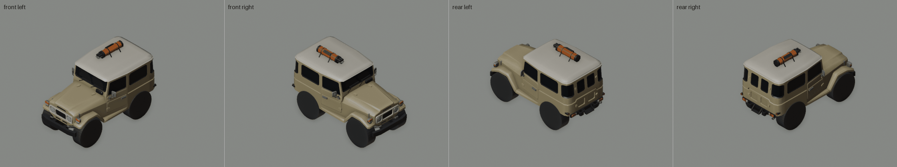
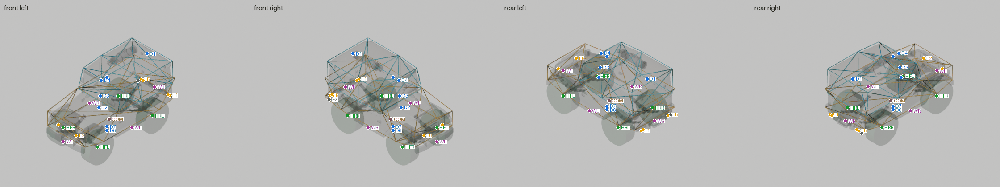
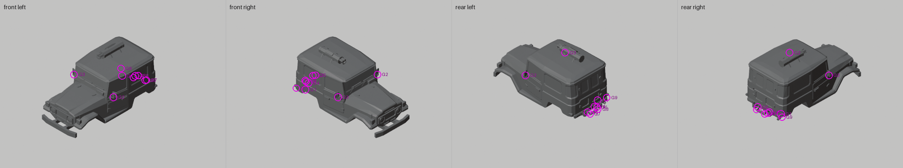

# DingDing

**Kind:** patch · **Base:** DingDing

A patch: changes to the game's own DingDing (Ding family, stock, with a golf bag on the roof).

The renders show geometry built from the player's own copy of the DingDing. This sheet ships pictures and numbers only, no mesh data.

## Isometric

## Rig

Body in X-ray with each connected piece in its own colour (431 pieces at LOD0); Collider/Top cyan, Collider/Base orange, wheel colliders green; attach points marked by id (table below; squares are upgrade-slot pivots).

| Id | Point | Category | Position (Unity root, m) | Nearest surface |
|---|---|---|---|---|
| HFL | `Axles/WheelColliders/WheelFL` | hub | (-0.715, +0.340, +1.265) |  |
| HFR | `Axles/WheelColliders/WheelFR` | hub | (+0.715, +0.340, +1.265) |  |
| HRL | `Axles/WheelColliders/WheelRL` | hub | (-0.715, +0.340, -1.029) |  |
| HRR | `Axles/WheelColliders/WheelRR` | hub | (+0.715, +0.340, -1.029) |  |
| COM | `CoM` | com | (+0.000, +0.400, +0.069) |  |
| WF | `Winch/WinchAttachPoints/Front` | winch | (+0.000, +0.537, +1.980) | 0.7 cm |
| WB | `Winch/WinchAttachPoints/Rear` | winch | (+0.000, +0.619, -1.840) | 1.8 cm |
| WL | `Winch/WinchAttachPoints/Left` | winch | (-0.887, +0.514, +0.000) | 3.1 cm |
| WR | `Winch/WinchAttachPoints/Right` | winch | (+0.887, +0.514, +0.000) | 3.1 cm |
| D1 | `WaterDetector/BackCarSubmerged` | water | (+0.000, +1.989, -1.517) |  |
| D2 | `WaterDetector/EngineAirIntakeWaterDetector_1` | water | (+0.000, +1.039, +0.496) |  |
| D3 | `WaterDetector/EngineAirIntakeWaterDetector_2` | water | (+0.000, +1.430, +0.431) |  |
| D4 | `WaterDetector/EngineAirIntakeWaterDetector_3` | water | (+0.000, +1.975, +0.394) |  |
| D5 | `WaterDetector/FrontCarSubmerged` | water | (+0.000, +1.969, +0.160) |  |
| D6 | `WaterDetector/IsTouchingWaterDetector` | water | (+0.000, +0.029, +0.150) |  |
| D7 | `WaterDetector/TiresFullySubmergedWaterDetector` | water | (+0.000, +0.164, +0.150) |  |
| L1 | `Lights/LeftBrakingBrakelight` | light | (-0.591, +0.583, -1.879) | 3.1 cm |
| L2 | `Lights/LeftHeadlight` | light | (-0.380, +0.879, +1.824) | 1.9 cm |
| L3 | `Lights/LeftPositionBrakelight` | light | (-0.591, +0.583, -1.879) | 3.1 cm |
| L4 | `Lights/LeftReverselight` | light | (-0.522, +0.584, -1.879) | 2.7 cm |
| L5 | `Lights/RightBrakingBrakelight` | light | (+0.591, +0.583, -1.879) | 3.1 cm |
| L6 | `Lights/RightHeadlight` | light | (+0.380, +0.879, +1.824) | 1.9 cm |
| L7 | `Lights/RightPositionBrakelight` | light | (+0.591, +0.583, -1.879) | 3.1 cm |
| L8 | `Lights/RightReverselight` | light | (+0.522, +0.584, -1.879) | 2.7 cm |
| EX | `Effects/VehicleParticles/ExhaustParticlesManager` | exhaust | (+0.676, +0.508, -1.835) | 2.0 cm |

## Analysis

### Attach points

| Id | Check | Result | |
|---|---|---|---|
| HFL | wheel mesh on its collider; tyre clear of the body above the hub (prefab pose) | mesh offset 0.0 cm, clearance +4.6 cm | pass |
| HFR | wheel mesh on its collider; tyre clear of the body above the hub (prefab pose) | mesh offset 0.0 cm, clearance +4.6 cm | pass |
| HRL | wheel mesh on its collider; tyre clear of the body above the hub (prefab pose) | mesh offset 0.0 cm, clearance +20.0 cm | pass |
| HRR | wheel mesh on its collider; tyre clear of the body above the hub (prefab pose) | mesh offset 0.0 cm, clearance +12.3 cm | pass |
| COM | centre of mass between the wheels (inside track and wheelbase, above the ground) | x -0.00, y 0.40, z +0.07 m; -0.14 m from the collider bottom | pass |
| COL | colliders (convex hulls) cover the LOD0 body no worse than the stock donor's: share of vertices over 10 cm outside within 5 points, worst within 10 cm | 14.9% over 10 cm outside, worst 33 cm (stock 10.8%, worst 23 cm) | **FAIL** |
| WF | winch point within 15 cm of a body or axle surface | 0.7 cm | pass |
| WB | winch point within 15 cm of a body or axle surface | 1.8 cm | pass |
| WL | winch point within 15 cm of a body or axle surface | 3.1 cm | pass |
| WR | winch point within 15 cm of a body or axle surface | 3.1 cm | pass |
| L1 | light point within 10 cm of a body or axle surface | 3.1 cm | pass |
| L2 | light point within 10 cm of a body or axle surface | 1.9 cm | pass |
| L3 | light point within 10 cm of a body or axle surface | 3.1 cm | pass |
| L4 | light point within 10 cm of a body or axle surface | 2.7 cm | pass |
| L5 | light point within 10 cm of a body or axle surface | 3.1 cm | pass |
| L6 | light point within 10 cm of a body or axle surface | 1.9 cm | pass |
| L7 | light point within 10 cm of a body or axle surface | 3.1 cm | pass |
| L8 | light point within 10 cm of a body or axle surface | 2.7 cm | pass |
| EX | exhaust point within 15 cm of a body or axle surface | 2.0 cm | pass |

### Mesh gaps and culled faces

`tools/check_holes.py` per body LOD: a culled patch is where the nearest surface is a back face the game doesn't draw; a gap is an enclosed hole with no surface. Fails at 90 cm² culled or 20 cm² gap.

| LOD | Triangles | Open edges | Culled patches (largest) | Gaps (largest) | |
|---|---|---|---|---|---|
| 0 | 2876 | 214 | 0 | 9 (4.8 cm²) | pass |
| 1 | 2459 | 211 | 0 | 8 (5 cm²) | pass |
| 2 | 1048 | 134 | 0 | 4 (5.5 cm²) | pass |
| 3 | 285 | 57 | 20 (85.5 cm²) | 8 (13.2 cm²) | pass |

| Gap (LOD0) | Area | At (OBJ, m) | Region |
|---|---|---|---|
| G1 | 4.8 cm² | (-0.554, +0.558, -1.584) | lower right |
| G2 | 4.8 cm² | (+0.915, +1.367, +0.285) | body left |
| G3 | 4.5 cm² | (-0.916, +1.365, +0.284) | body right |
| G4 | 3.2 cm² | (-0.218, +0.562, -1.771) | lower centre |
| G5 | 3.2 cm² | (+0.211, +0.606, -1.889) | lower centre |
| G6 | 2.5 cm² | (-0.234, +0.578, -1.872) | lower centre |
| G7 | 2 cm² | (+0.184, +0.563, -1.977) | lower centre |
| G8 | 2 cm² | (-0.190, +0.563, -1.967) | lower centre |
| G9 | 2 cm² | (-0.794, +0.642, -1.770) | lower right |

### Slivers and triangles

Slivers (faces over 1.5 m long with under 0.01 m² area): none in 8 meshes.

| Mesh | Triangles | Source |
|---|---|---|
| body_LOD0 | 2876 | built |
| body_LOD1 | 2459 | built |
| body_LOD2 | 1048 | built |
| body_LOD3 | 285 | built |
| axle_front_LOD0 | 700 | stock |
| axle_rear_LOD0 | 700 | stock |
| collider_top | 20 | stock |
| collider_base | 24 | stock |

## Facts

| Length | Width | Height | Wheelbase | Track | Ground clearance |
|---|---|---|---|---|---|
| 3.97 m | 2.05 m | 2.54 m | 2.29 m | 1.43 m | 0.47 m |

Height and ground clearance are in the prefab pose (wheels at their modelled hub height, tyres on the ground); suspension sag at rest is not modelled.

| Chassis | Value |
|---|---|
| wheelbase | `2.294` |
| track | `1.43` |
| bodyCut | `[]` |

Generated by Die Kollektion Werkstatt, tools/contact_sheet.py (prototype of `kollektion contact`) from [`contact/contact.json`](contact/contact.json). The real vehicle this one is modelled on is listed in the catalogue in the [main README](../../README.md).
