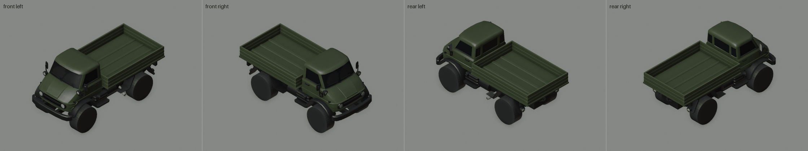
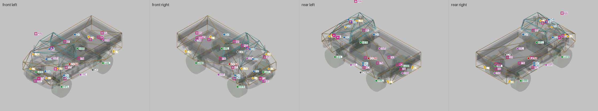
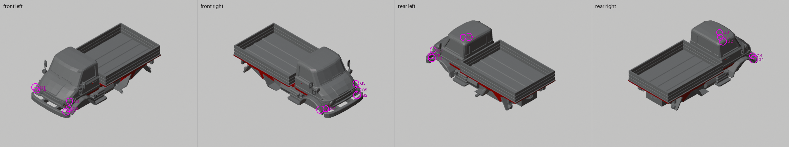

# Das Mastodon

**Kind:** based · **Base:** Mammoth · **Item:** 3000000002

A new vehicle built from the game's Mammoth (Mammoth family, two-door, long wheelbase).

The renders show geometry built from the player's own copy of the Mammoth. This sheet ships pictures and numbers only, no mesh data.

## Isometric

## Rig

Body in X-ray with each connected piece in its own colour (545 pieces at LOD0); Collider/Top cyan, Collider/Base orange, wheel colliders green; attach points marked by id (table below; squares are upgrade-slot pivots).

| Id | Point | Category | Position (Unity root, m) | Nearest surface |
|---|---|---|---|---|
| HFL | `Axles/WheelColliders/WheelFL` | hub | (-0.900, +0.448, +1.221) |  |
| HFR | `Axles/WheelColliders/WheelFR` | hub | (+0.900, +0.448, +1.221) |  |
| HRL | `Axles/WheelColliders/WheelRL` | hub | (-0.900, +0.448, -1.679) |  |
| HRR | `Axles/WheelColliders/WheelRR` | hub | (+0.900, +0.448, -1.679) |  |
| COM | `CoM` | com | (+0.000, +0.650, -0.236) |  |
| WF | `Winch/WinchAttachPoints/Front` | winch | (+0.000, +0.804, +2.125) | 1.7 cm |
| WB | `Winch/WinchAttachPoints/Rear` | winch | (+0.000, +0.935, -2.607) | 2.2 cm |
| WL | `Winch/WinchAttachPoints/Left` | winch | (-1.003, +0.634, +0.000) | 1.2 cm |
| WR | `Winch/WinchAttachPoints/Right` | winch | (+1.003, +0.634, +0.000) | 1.2 cm |
| D1 | `WaterDetector/BackCarSubmerged` | water | (+0.000, +2.289, -0.609) |  |
| D2 | `WaterDetector/EngineAirIntakeWaterDetector_1` | water | (+0.000, +1.075, +1.459) |  |
| D3 | `WaterDetector/EngineAirIntakeWaterDetector_2` | water | (+0.000, +1.784, +1.400) |  |
| D4 | `WaterDetector/EngineAirIntakeWaterDetector_3` | water | (+0.000, +2.297, +1.193) |  |
| D5 | `WaterDetector/FrontCarSubmerged` | water | (+0.000, +2.259, +0.970) |  |
| D6 | `WaterDetector/IsTouchingWaterDetector` | water | (+0.000, +0.029, +0.150) |  |
| D7 | `WaterDetector/TiresFullySubmergedWaterDetector` | water | (+0.000, +0.164, +0.150) |  |
| L1 | `Lights/LeftBrakingBrakelight` | light | (-0.850, +0.725, -2.450) | 2.3 cm |
| L2 | `Lights/LeftHeadlight` | light | (-0.560, +1.178, +1.956) | 0.3 cm |
| L3 | `Lights/LeftPositionBrakelight` | light | (-0.850, +0.725, -2.450) | 2.3 cm |
| L4 | `Lights/LeftReverselight` | light | (-0.880, +0.794, -2.444) | 1.7 cm |
| L5 | `Lights/LeftSpotlightFlare` | light | (-0.860, +1.670, +1.467) | 0.5 cm |
| L6 | `Lights/RightBrakingBrakelight` | light | (+0.850, +0.725, -2.450) | 2.3 cm |
| L7 | `Lights/RightHeadlight` | light | (+0.560, +1.178, +1.956) | 0.3 cm |
| L8 | `Lights/RightPositionBrakelight` | light | (+0.850, +0.725, -2.450) | 2.3 cm |
| L9 | `Lights/RightReverselight` | light | (+0.880, +0.794, -2.444) | 1.7 cm |
| L10 | `Lights/RightSpotlightFlare` | light | (+0.860, +1.670, +1.467) | 0.5 cm |
| EX | `Effects/VehicleParticles/ExhaustParticlesManager` | exhaust | (-1.089, +0.587, -0.765) | 3.9 cm |
| AN | `upgrade slot Antenna (17 options; median pivot)` | slot | (+0.729, +2.967, +1.387) | 72.9 cm |
| BD | `upgrade slot Bed (7 options; median pivot)` | slot | (+0.000, +1.284, -2.268) | 4.1 cm |
| FN | `upgrade slot Fender (28 options; median pivot)` | slot | (+0.000, +0.678, -0.874) | 18.0 cm |
| FS | `upgrade slot Front (13 options; median pivot)` | slot | (+0.000, +0.866, +1.922) | 7.4 cm |
| FB | `upgrade slot Front_Bumper (21 options; median pivot)` | slot | (+0.000, +0.830, +2.174) | 1.5 cm |
| RS | `upgrade slot Rear (20 options; median pivot)` | slot | (+0.000, +1.427, -2.509) | 18.7 cm |
| RB | `upgrade slot Rear_Bumper (20 options; median pivot)` | slot | (+0.000, +1.127, -2.497) | 1.6 cm |
| RC | `upgrade slot Rollcage (1 options; median pivot)` | slot | (+0.000, -0.071, +0.086) | 65.2 cm |
| RF | `upgrade slot Roof (19 options; median pivot)` | slot | (+0.001, +2.199, +0.108) | 4.7 cm |
| RL | `upgrade slot Roof_Bar (17 options; median pivot)` | slot | (+0.000, +2.264, +1.012) | 10.6 cm |
| SD | `upgrade slot Side (26 options; median pivot)` | slot | (-0.006, +1.439, -1.680) | 19.8 cm |
| ST | `upgrade slot Side_Step (4 options; median pivot)` | slot | (+0.000, +0.575, -0.014) | 23.0 cm |
| SN | `upgrade slot Snorkel (2 options; median pivot)` | slot | (-0.729, +1.589, +1.476) | 6.2 cm |
| WN | `upgrade slot Winch (1 options; median pivot)` | slot | (+0.000, +0.829, +1.932) | 10.9 cm |

## Analysis

### Attach points

| Id | Check | Result | |
|---|---|---|---|
| HFL | wheel mesh on its collider; tyre clear of the body above the hub (prefab pose) | mesh offset 0.0 cm, clearance +11.6 cm | pass |
| HFR | wheel mesh on its collider; tyre clear of the body above the hub (prefab pose) | mesh offset 0.0 cm, clearance +11.6 cm | pass |
| HRL | wheel mesh on its collider; tyre clear of the body above the hub (prefab pose) | mesh offset 0.0 cm, clearance +15.3 cm | pass |
| HRR | wheel mesh on its collider; tyre clear of the body above the hub (prefab pose) | mesh offset 0.0 cm, clearance +15.3 cm | pass |
| COM | centre of mass between the wheels (inside track and wheelbase, above the ground) | x -0.00, y 0.65, z -0.24 m; -0.08 m from the collider bottom | pass |
| COL | colliders (convex hulls) cover the LOD0 body no worse than the stock donor's: share of vertices over 10 cm outside within 5 points, worst within 10 cm | 9.6% over 10 cm outside, worst 57 cm (stock 9.4%, worst 34 cm) | **FAIL** |
| WF | winch point within 15 cm of a body or axle surface | 1.7 cm | pass |
| WB | winch point within 15 cm of a body or axle surface | 2.2 cm | pass |
| WL | winch point within 15 cm of a body or axle surface | 1.2 cm | pass |
| WR | winch point within 15 cm of a body or axle surface | 1.2 cm | pass |
| L1 | light point within 10 cm of a body or axle surface | 2.3 cm | pass |
| L2 | light point within 10 cm of a body or axle surface | 0.3 cm | pass |
| L3 | light point within 10 cm of a body or axle surface | 2.3 cm | pass |
| L4 | light point within 10 cm of a body or axle surface | 1.7 cm | pass |
| L5 | light point within 10 cm of a body or axle surface | 0.5 cm | pass |
| L6 | light point within 10 cm of a body or axle surface | 2.3 cm | pass |
| L7 | light point within 10 cm of a body or axle surface | 0.3 cm | pass |
| L8 | light point within 10 cm of a body or axle surface | 2.3 cm | pass |
| L9 | light point within 10 cm of a body or axle surface | 1.7 cm | pass |
| L10 | light point within 10 cm of a body or axle surface | 0.5 cm | pass |
| EX | exhaust point within 15 cm of a body or axle surface | 3.9 cm | pass |
| AN | upgrade-slot pivot no further from the body than on the stock donor (+15 cm) | 72.9 cm (stock 72.9 cm) | pass |
| BD | upgrade-slot pivot no further from the body than on the stock donor (+15 cm) | 4.1 cm (stock 4.1 cm) | pass |
| FN | upgrade-slot pivot no further from the body than on the stock donor (+15 cm) | 18.0 cm (stock 18.1 cm) | pass |
| FS | upgrade-slot pivot no further from the body than on the stock donor (+15 cm) | 7.4 cm (stock 7.4 cm) | pass |
| FB | upgrade-slot pivot no further from the body than on the stock donor (+15 cm) | 1.5 cm (stock 1.5 cm) | pass |
| RS | upgrade-slot pivot no further from the body than on the stock donor (+15 cm) | 18.7 cm (stock 0.8 cm) | **FAIL** |
| RB | upgrade-slot pivot no further from the body than on the stock donor (+15 cm) | 1.6 cm (stock 1.6 cm) | pass |
| RC | upgrade-slot pivot no further from the body than on the stock donor (+15 cm) | 65.2 cm (stock 65.2 cm) | pass |
| RF | upgrade-slot pivot no further from the body than on the stock donor (+15 cm) | 4.7 cm (stock 19.5 cm) | pass |
| RL | upgrade-slot pivot no further from the body than on the stock donor (+15 cm) | 10.6 cm (stock 10.6 cm) | pass |
| SD | upgrade-slot pivot no further from the body than on the stock donor (+15 cm) | 19.8 cm (stock 11.8 cm) | pass |
| ST | upgrade-slot pivot no further from the body than on the stock donor (+15 cm) | 23.0 cm (stock 23.0 cm) | pass |
| SN | upgrade-slot pivot no further from the body than on the stock donor (+15 cm) | 6.2 cm (stock 6.2 cm) | pass |
| WN | upgrade-slot pivot no further from the body than on the stock donor (+15 cm) | 10.9 cm (stock 10.9 cm) | pass |

### Mesh gaps and culled faces

`tools/check_holes.py` per body LOD: a culled patch is where the nearest surface is a back face the game doesn't draw; a gap is an enclosed hole with no surface. Fails at 25 cm² culled or 20 cm² gap.

| LOD | Triangles | Open edges | Culled patches (largest) | Gaps (largest) | |
|---|---|---|---|---|---|
| 0 | 3104 | 282 | 38 (524.2 cm²) | 5 (16.2 cm²) | **FAIL** |
| 1 | 2372 | 262 | 34 (526.5 cm²) | 8 (13.2 cm²) | **FAIL** |
| 2 | 1404 | 214 | 37 (493.8 cm²) | 11 (10.5 cm²) | **FAIL** |
| 3 | 541 | 101 | 49 (488.5 cm²) | 4 (3.2 cm²) | **FAIL** |

| Gap (LOD0) | Area | At (OBJ, m) | Region |
|---|---|---|---|
| G1 | 16.2 cm² | (-1.032, +1.004, +1.728) | lower right |
| G2 | 15.2 cm² | (+0.763, +0.858, +1.885) | lower left |
| G3 | 4.2 cm² | (+0.823, +1.315, +1.764) | body left |
| G4 | 3.8 cm² | (-0.856, +1.027, +1.844) | lower right |
| G5 | 3.2 cm² | (+0.858, +1.026, +1.842) | lower left |

| Culled patch (LOD0), along z | Area | Triangles | Region |
|---|---|---|---|
| -2.13..-0.86 m | 524.2 cm² | 1 | lower right |
| -2.13..-0.86 m | 522.5 cm² | 1 | lower left |
| -2.13..-0.86 m | 263 cm² | 1 | body left |
| -2.13..-0.86 m | 262.2 cm² | 1 | body right |
| -2.13..-0.86 m | 164.8 cm² | 4 | body right |
| -2.13..-0.86 m | 163.8 cm² | 4 | body left |
| -2.85..+0.10 m | 134.8 cm² | 1 | body centre |
| -1.68..+0.21 m | 112.2 cm² | 1 | lower right |

### Slivers and triangles

Slivers (faces over 1.5 m long with under 0.01 m² area): none in 14 meshes.

| Mesh | Triangles | Source |
|---|---|---|
| body_LOD0 | 3104 | built |
| body_LOD1 | 2372 | built |
| body_LOD2 | 1404 | built |
| body_LOD3 | 541 | built |
| axle_front_LOD0 | 4076 | built |
| axle_rear_LOD0 | 4076 | built |
| collider_top | 20 | built |
| collider_base | 24 | built |

## Facts

| Length | Width | Height | Wheelbase | Track | Ground clearance |
|---|---|---|---|---|---|
| 5.02 m | 2.20 m | 2.44 m | 2.90 m | 1.80 m | 0.46 m |

Height and ground clearance are in the prefab pose (wheels at their modelled hub height, tyres on the ground); suspension sag at rest is not modelled.

| Chassis | Value |
|---|---|
| wheelbase | `2.9` |
| track | `1.8` |
| maxSteerAngle | `37.8` |
| wheel | `{"radius": 0.52, "width": 0.4, "y": 0.45}` |
| suspension | `{"travel": 0.55, "anchor": 0.62, "springRate": 18300, "damperRate": 4500, "preloadDistance": 0.0, "bumpTravelOffset": 0.05}` |
| bodyCut | `[[0.0, -0.62], [1.05, -0.865], [1.21, -1.45]]` |

Generated by Die Kollektion Werkstatt, tools/contact_sheet.py (prototype of `kollektion contact`) from [`contact/contact.json`](contact/contact.json). The real vehicle this one is modelled on is listed in the catalogue in the [main README](../../README.md).
