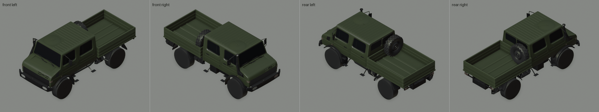
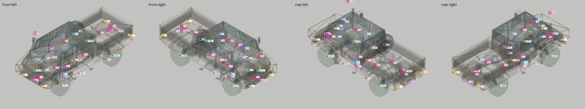
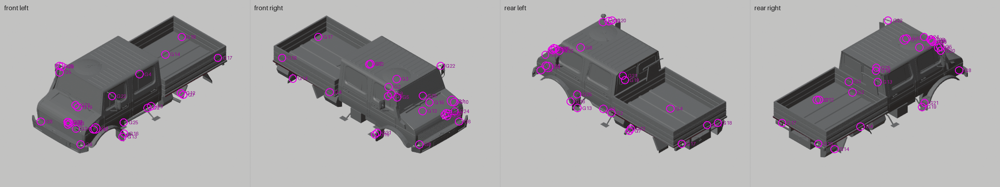

# Das Megaloceros

**Kind:** based · **Base:** Mammoth · **Item:** 3000000004

A new vehicle built from the game's Mammoth (Glyptodon family, crew cab).

The renders show geometry built from the player's own copy of the Mammoth. This sheet ships pictures and numbers only, no mesh data.

## Isometric

## Rig

Body in X-ray with each connected piece in its own colour (1526 pieces at LOD0); Collider/Top cyan, Collider/Base orange, wheel colliders green; attach points marked by id (table below; squares are upgrade-slot pivots).

| Id | Point | Category | Position (Unity root, m) | Nearest surface |
|---|---|---|---|---|
| HFL | `Axles/WheelColliders/WheelFL` | hub | (-0.930, +0.448, +1.221) |  |
| HFR | `Axles/WheelColliders/WheelFR` | hub | (+0.930, +0.448, +1.221) |  |
| HRL | `Axles/WheelColliders/WheelRL` | hub | (-0.930, +0.448, -2.479) |  |
| HRR | `Axles/WheelColliders/WheelRR` | hub | (+0.930, +0.448, -2.479) |  |
| COM | `CoM` | com | (+0.000, +0.650, -0.638) |  |
| WF | `Winch/WinchAttachPoints/Front` | winch | (+0.000, +0.850, +2.300) | 2.0 cm |
| WB | `Winch/WinchAttachPoints/Rear` | winch | (+0.000, +0.880, -3.785) | 1.1 cm |
| WL | `Winch/WinchAttachPoints/Left` | winch | (-1.003, +0.634, +0.000) | 13.3 cm |
| WR | `Winch/WinchAttachPoints/Right` | winch | (+1.003, +0.634, +0.000) | 13.3 cm |
| D1 | `WaterDetector/BackCarSubmerged` | water | (+0.000, +2.289, -0.609) |  |
| D2 | `WaterDetector/EngineAirIntakeWaterDetector_1` | water | (+0.000, +1.075, +1.459) |  |
| D3 | `WaterDetector/EngineAirIntakeWaterDetector_2` | water | (+0.000, +1.784, +1.400) |  |
| D4 | `WaterDetector/EngineAirIntakeWaterDetector_3` | water | (+0.000, +2.297, +1.193) |  |
| D5 | `WaterDetector/FrontCarSubmerged` | water | (+0.000, +2.259, +0.970) |  |
| D6 | `WaterDetector/IsTouchingWaterDetector` | water | (+0.000, +0.029, +0.150) |  |
| D7 | `WaterDetector/TiresFullySubmergedWaterDetector` | water | (+0.000, +0.164, +0.150) |  |
| L1 | `Lights/LeftBrakingBrakelight` | light | (-0.885, +1.040, -3.795) | 3.5 cm |
| L2 | `Lights/LeftHeadlight` | light | (-0.700, +0.830, +2.300) | 4.3 cm |
| L3 | `Lights/LeftPositionBrakelight` | light | (-0.885, +1.040, -3.795) | 3.5 cm |
| L4 | `Lights/LeftReverselight` | light | (-0.800, +1.040, -3.795) | 4.8 cm |
| L5 | `Lights/LeftSpotlightFlare` | light | (-0.700, +0.830, +2.300) | 4.3 cm |
| L6 | `Lights/RightBrakingBrakelight` | light | (+0.885, +1.040, -3.795) | 3.5 cm |
| L7 | `Lights/RightHeadlight` | light | (+0.700, +0.830, +2.300) | 4.2 cm |
| L8 | `Lights/RightPositionBrakelight` | light | (+0.885, +1.040, -3.795) | 3.5 cm |
| L9 | `Lights/RightReverselight` | light | (+0.800, +1.040, -3.795) | 4.8 cm |
| L10 | `Lights/RightSpotlightFlare` | light | (+0.700, +0.830, +2.300) | 4.2 cm |
| EX | `Effects/VehicleParticles/ExhaustParticlesManager` | exhaust | (-1.170, +0.690, -1.770) | 1.0 cm |
| SP | `spare (Mammoth_wheel)` | spare | (+0.520, +1.785, -1.431) | 18.2 cm |
| AN | `upgrade slot Antenna (17 options; median pivot)` | slot | (+0.729, +2.967, +1.387) | 53.2 cm |
| BD | `upgrade slot Bed (7 options; median pivot)` | slot | (+0.000, +1.284, -3.068) | 12.5 cm |
| FN | `upgrade slot Fender (28 options; median pivot)` | slot | (+0.000, +0.678, -1.274) | 4.6 cm |
| FS | `upgrade slot Front (13 options; median pivot)` | slot | (+0.000, +0.866, +1.922) | 7.4 cm |
| FB | `upgrade slot Front_Bumper (21 options; median pivot)` | slot | (+0.000, +0.830, +2.174) | 2.4 cm |
| RS | `upgrade slot Rear (20 options; median pivot)` | slot | (+0.000, +1.427, -3.309) | 18.7 cm |
| RB | `upgrade slot Rear_Bumper (20 options; median pivot)` | slot | (+0.000, +1.127, -3.297) | 6.4 cm |
| RC | `upgrade slot Rollcage (1 options; median pivot)` | slot | (+0.000, -0.071, +0.086) | 50.1 cm |
| RF | `upgrade slot Roof (19 options; median pivot)` | slot | (+0.001, +2.199, +0.108) | 19.5 cm |
| RL | `upgrade slot Roof_Bar (17 options; median pivot)` | slot | (+0.000, +2.264, +1.012) | 2.4 cm |
| SD | `upgrade slot Side (26 options; median pivot)` | slot | (-0.006, +1.439, -2.480) | 21.6 cm |
| ST | `upgrade slot Side_Step (4 options; median pivot)` | slot | (+0.000, +0.575, -0.014) | 12.8 cm |
| SN | `upgrade slot Snorkel (2 options; median pivot)` | slot | (-0.729, +1.589, +1.476) | 5.2 cm |
| WN | `upgrade slot Winch (1 options; median pivot)` | slot | (+0.000, +0.829, +1.932) | 10.9 cm |

## Analysis

### Attach points

| Id | Check | Result | |
|---|---|---|---|
| HFL | wheel mesh on its collider; tyre clear of the body above the hub (prefab pose) | mesh offset 0.0 cm, clearance +7.2 cm | pass |
| HFR | wheel mesh on its collider; tyre clear of the body above the hub (prefab pose) | mesh offset 0.0 cm, clearance +7.2 cm | pass |
| HRL | wheel mesh on its collider; tyre clear of the body above the hub (prefab pose) | mesh offset 0.0 cm, clearance +12.8 cm | pass |
| HRR | wheel mesh on its collider; tyre clear of the body above the hub (prefab pose) | mesh offset 0.0 cm, clearance +12.8 cm | pass |
| COM | centre of mass between the wheels (inside track and wheelbase, above the ground) | x -0.00, y 0.65, z -0.64 m; -0.08 m from the collider bottom | pass |
| COL | colliders (convex hulls) cover the LOD0 body no worse than the stock donor's: share of vertices over 10 cm outside within 5 points, worst within 10 cm | 10.4% over 10 cm outside, worst 47 cm (stock 9.4%, worst 34 cm) | **FAIL** |
| WF | winch point within 15 cm of a body or axle surface | 2.0 cm | pass |
| WB | winch point within 15 cm of a body or axle surface | 1.1 cm | pass |
| WL | winch point within 15 cm of a body or axle surface | 13.3 cm | pass |
| WR | winch point within 15 cm of a body or axle surface | 13.3 cm | pass |
| L1 | light point within 10 cm of a body or axle surface | 3.5 cm | pass |
| L2 | light point within 10 cm of a body or axle surface | 4.3 cm | pass |
| L3 | light point within 10 cm of a body or axle surface | 3.5 cm | pass |
| L4 | light point within 10 cm of a body or axle surface | 4.8 cm | pass |
| L5 | light point within 10 cm of a body or axle surface | 4.3 cm | pass |
| L6 | light point within 10 cm of a body or axle surface | 3.5 cm | pass |
| L7 | light point within 10 cm of a body or axle surface | 4.2 cm | pass |
| L8 | light point within 10 cm of a body or axle surface | 3.5 cm | pass |
| L9 | light point within 10 cm of a body or axle surface | 4.8 cm | pass |
| L10 | light point within 10 cm of a body or axle surface | 4.2 cm | pass |
| EX | exhaust point within 15 cm of a body or axle surface | 1.0 cm | pass |
| SP | spare point within 23 cm of a body or axle surface | 18.2 cm | pass |
| AN | upgrade-slot pivot no further from the body than on the stock donor (+15 cm) | 53.2 cm (stock 72.9 cm) | pass |
| BD | upgrade-slot pivot no further from the body than on the stock donor (+15 cm) | 12.5 cm (stock 4.1 cm) | pass |
| FN | upgrade-slot pivot no further from the body than on the stock donor (+15 cm) | 4.6 cm (stock 18.1 cm) | pass |
| FS | upgrade-slot pivot no further from the body than on the stock donor (+15 cm) | 7.4 cm (stock 7.4 cm) | pass |
| FB | upgrade-slot pivot no further from the body than on the stock donor (+15 cm) | 2.4 cm (stock 1.5 cm) | pass |
| RS | upgrade-slot pivot no further from the body than on the stock donor (+15 cm) | 18.7 cm (stock 0.8 cm) | **FAIL** |
| RB | upgrade-slot pivot no further from the body than on the stock donor (+15 cm) | 6.4 cm (stock 1.6 cm) | pass |
| RC | upgrade-slot pivot no further from the body than on the stock donor (+15 cm) | 50.1 cm (stock 65.2 cm) | pass |
| RF | upgrade-slot pivot no further from the body than on the stock donor (+15 cm) | 19.5 cm (stock 19.5 cm) | pass |
| RL | upgrade-slot pivot no further from the body than on the stock donor (+15 cm) | 2.4 cm (stock 10.6 cm) | pass |
| SD | upgrade-slot pivot no further from the body than on the stock donor (+15 cm) | 21.6 cm (stock 11.8 cm) | pass |
| ST | upgrade-slot pivot no further from the body than on the stock donor (+15 cm) | 12.8 cm (stock 23.0 cm) | pass |
| SN | upgrade-slot pivot no further from the body than on the stock donor (+15 cm) | 5.2 cm (stock 6.2 cm) | pass |
| WN | upgrade-slot pivot no further from the body than on the stock donor (+15 cm) | 10.9 cm (stock 10.9 cm) | pass |

### Mesh gaps and culled faces

`tools/check_holes.py` per body LOD: a culled patch is where the nearest surface is a back face the game doesn't draw; a gap is an enclosed hole with no surface. Fails at 25 cm² culled or 20 cm² gap.

| LOD | Triangles | Open edges | Culled patches (largest) | Gaps (largest) | |
|---|---|---|---|---|---|
| 0 | 13336 | 497 | 3 (5.8 cm²) | 26 (13.8 cm²) | pass |
| 1 | 11359 | 495 | 2 (2.5 cm²) | 32 (14.5 cm²) | pass |
| 2 | 8259 | 371 | 25 (8.5 cm²) | 37 (14.5 cm²) | pass |
| 3 | 7551 | 307 | 20 (8.5 cm²) | 39 (16.5 cm²) | pass |

| Gap (LOD0) | Area | At (OBJ, m) | Region |
|---|---|---|---|
| G1 | 13.8 cm² | (+0.998, +1.346, +1.629) | body left |
| G2 | 4 cm² | (+0.758, +0.762, -0.787) | lower left |
| G3 | 3.8 cm² | (+0.994, +0.981, -0.695) | lower left |
| G4 | 3.8 cm² | (-0.650, +0.749, -1.849) | lower right |
| G5 | 3.8 cm² | (-0.905, +2.235, +1.232) | greenhouse right |
| G6 | 3.5 cm² | (+0.832, +0.910, +2.093) | lower left |
| G7 | 3.5 cm² | (+1.124, +0.858, -1.911) | lower left |
| G8 | 3.5 cm² | (-0.833, +0.910, +2.093) | lower right |
| G9 | 3.5 cm² | (-0.978, +2.316, +1.061) | greenhouse right |
| G10 | 3.5 cm² | (+0.997, +1.346, +1.721) | body left |
| G11 | 3.5 cm² | (+0.308, +1.457, +2.073) | body left |
| G12 | 3.2 cm² | (+1.047, +0.894, -1.893) | lower left |
| G13 | 3.2 cm² | (+0.940, +0.418, +0.450) | lower left |
| G14 | 3.2 cm² | (-0.876, +0.698, -3.167) | lower right |
| G15 | 2.8 cm² | (+0.313, +1.380, +2.106) | body left |
| G16 | 2.5 cm² | (+1.121, +0.689, +0.558) | lower left |
| G17 | 2.5 cm² | (+0.758, +1.116, -3.730) | lower left |
| G18 | 2.5 cm² | (-0.758, +1.114, -3.726) | lower right |
| G19 | 2.5 cm² | (-0.983, +0.504, +0.389) | lower right |
| G20 | 2.2 cm² | (-1.101, +2.276, +1.049) | greenhouse right |
| G21 | 2.2 cm² | (-0.990, +0.618, +0.482) | lower right |
| G22 | 2.2 cm² | (+1.101, +2.276, +1.049) | greenhouse left |
| G23 | 2.2 cm² | (+0.371, +1.437, +2.086) | body left |
| G24 | 2.2 cm² | (+0.638, +1.382, +2.098) | body left |
| G25 | 2 cm² | (+0.972, +0.945, +0.423) | lower left |
| G26 | 2 cm² | (+0.253, +1.426, +2.057) | body centre |

| Culled patch (LOD0), along z | Area | Triangles | Region |
|---|---|---|---|
| -3.75..-3.75 m | 5.8 cm² | 1 | body centre |
| -3.75..-1.16 m | 4.2 cm² | 1 | body right |
| -3.75..-1.16 m | 4.2 cm² | 1 | body left |

### Slivers and triangles

Slivers (faces over 1.5 m long with under 0.01 m² area): `body_LOD0.obj` 22, `body_LOD1.obj` 20, `body_LOD2.obj` 12, `body_LOD3.obj` 12.

| Mesh | Triangles | Source |
|---|---|---|
| body_LOD0 | 13336 | built |
| body_LOD1 | 11359 | built |
| body_LOD2 | 8259 | built |
| body_LOD3 | 7551 | built |
| axle_front_LOD0 | 4076 | built |
| axle_rear_LOD0 | 4076 | built |
| collider_top | 20 | built |
| collider_base | 24 | built |

## Facts

| Length | Width | Height | Wheelbase | Track | Ground clearance |
|---|---|---|---|---|---|
| 6.08 m | 2.71 m | 2.59 m | 3.70 m | 1.86 m | 0.43 m |

Height and ground clearance are in the prefab pose (wheels at their modelled hub height, tyres on the ground); suspension sag at rest is not modelled.

| Chassis | Value |
|---|---|
| wheelbase | `3.7` |
| track | `1.86` |
| maxSteerAngle | `37.8` |
| wheel | `{"radius": 0.52, "width": 0.4, "y": 0.45}` |
| tyre | `{"radius": 0.545, "width": 0.352}` |
| suspension | `{"travel": 0.4, "anchor": 0.725, "springRate": 18300, "damperRate": 4500, "preloadDistance": 0.1, "bumpTravelOffset": 0.03}` |
| bodyCut | `[[0.0, -0.62], [1.05, -0.865], [1.21, -1.45]]` |

Generated by Die Kollektion Werkstatt, tools/contact_sheet.py (prototype of `kollektion contact`) from [`contact/contact.json`](contact/contact.json). The real vehicle this one is modelled on is listed in the catalogue in the [main README](../../README.md).
